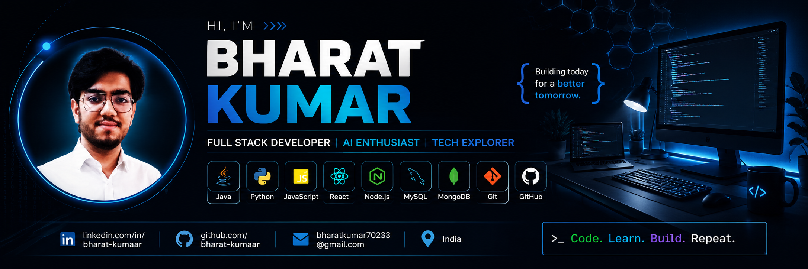

<p align="center">
  
</p>

<p align="center">
  
</p>

<!-- ======================================================== -->
<!-- 🔥 DYNAMIC HOLOGRAPHIC TYPING HEADER -->
<!-- ======================================================== -->
<h1 align="center">
  <a href="https://github.com/bharat-kumaar">
    
  </a>
</h1>

<!-- ======================================================== -->
<!-- 🚀 MISSION CONTROL BADGES -->
<!-- ======================================================== -->
<p align="center">
  <a href="https://github.com/bharat-kumaar">
    
  </a>
  &nbsp;
  <a href="https://github.com/bharat-kumaar?tab=followers">
    
  </a>
  &nbsp;
  <a href="https://github.com/bharat-kumaar?tab=repositories">
    
  </a>
  &nbsp;
  <a href="https://www.linkedin.com/in/bharat-kumaar/">
    
  </a>
</p>

<p align="center">
  
  &nbsp;
  
  &nbsp;
  
  &nbsp;
  
  &nbsp;
  
</p>

<!-- ======================================================== -->
<!-- 🕹️ CYBER ARCADE 2077 // LIVE RETRO GAME LAUNCHER -->
<!-- ======================================================== -->
<div align="center">
  <table border="0" width="100%">
    <tr>
      <td align="center" style="background: rgba(10, 8, 22, 0.9); border: 2px solid #00f7ff; border-radius: 16px; padding: 1.5rem; box-shadow: 0 0 35px rgba(0, 247, 255, 0.4);">
        <h2 style="color: #00f7ff; margin: 0 0 0.5rem 0; font-family: sans-serif;">
          🎮 CYBER DEFENDER 2077 // PLAYABLE ARCADE &amp; GLOBAL LEADERBOARD
        </h2>
        <p style="color: #cbd5e1; font-size: 0.95rem; margin-bottom: 0.8rem;">
          Visiting my profile? Play the 60 FPS retro arcade shooter, defeat glitch daemons, and <strong>submit your score to the live Global Hall of Fame</strong> to compete with other visitors!
        </p>
        <p>
          
          
          
          
        </p>
        <p>
          <a href="https://bharat-kumaar.github.io#arcade">
            
          </a>
          &nbsp;&nbsp;
          <a href="https://bharat-kumaar.github.io#arcade">
            
          </a>
        </p>
      </td>
    </tr>
  </table>
</div>

<!-- ======================================================== -->
<!-- 🏆 LIVE GLOBAL LEADERBOARD PREVIEW -->
<!-- ======================================================== -->
<h3 align="center">
  
</h3>

<div align="center">
  <table width="90%" border="0">
    <thead>
      <tr style="border-bottom: 2px solid #00f7ff;">
        <th align="center">Rank</th>
        <th align="left">Callsign</th>
        <th align="center">High Score</th>
        <th align="center">Wave Reached</th>
        <th align="center">Badge</th>
      </tr>
    </thead>
    <tbody>
      <tr>
        <td align="center">🥇 <b>#1</b></td>
        <td align="left"><b>BHARAT_KUMAR</b></td>
        <td align="center"><code style="color:#00f7ff;">2,850</code></td>
        <td align="center">Wave 6</td>
        <td align="center"><code>DEV 👑</code></td>
      </tr>
      <tr>
        <td align="center">🥈 <b>#2</b></td>
        <td align="left"><b>CYBER_VIPER</b></td>
        <td align="center"><code style="color:#00f7ff;">2,420</code></td>
        <td align="center">Wave 5</td>
        <td align="center"><code>PRO 🔥</code></td>
      </tr>
      <tr>
        <td align="center">🥉 <b>#3</b></td>
        <td align="left"><b>NEO_MATRIX</b></td>
        <td align="center"><code style="color:#00f7ff;">1,980</code></td>
        <td align="center">Wave 4</td>
        <td align="center"><code>ELITE ⚡</code></td>
      </tr>
      <tr>
        <td align="center">🎖️ <b>#4</b></td>
        <td align="left"><b>SHADOW_SYS</b></td>
        <td align="center"><code style="color:#00f7ff;">1,650</code></td>
        <td align="center">Wave 4</td>
        <td align="center"><code>ACE 🎯</code></td>
      </tr>
      <tr>
        <td align="center">🎖️ <b>#5</b></td>
        <td align="left"><b>GLITCH_HUNTER</b></td>
        <td align="center"><code style="color:#00f7ff;">1,410</code></td>
        <td align="center">Wave 3</td>
        <td align="center"><code>RUNNER 🚀</code></td>
      </tr>
    </tbody>
  </table>
  <p>
    <em>Can you beat the developer's high score of <strong>2,850</strong>? <a href="https://bharat-kumaar.github.io#arcade"><strong>Play and enter your callsign to challenge the leaderboard »</strong></a></em>
  </p>
</div>

<!-- ======================================================== -->
<!-- 🧩 INTERACTIVE GITHUB MINI-GAME // QUANTUM HACK CHALLENGE -->
<!-- ======================================================== -->
<h3 align="center">
  
</h3>

<div align="center">
  <p><em>A rogue glitch daemon has locked the quantum mainframe. Click a key below to attempt decryption:</em></p>
</div>

<details>
<summary><b>🔹 KEY 0x1A: [01001000 - BRUTE_FORCE_CIPHER] (Click to Test)</b></summary>
<br/>
<p align="center">
  ❌ <b>FIREWALL LOCKDOWN ENGAGED!</b> Security intrusion thwarted. <br/>
  <em>Hint: The correct key relies on neural architecture &amp; AI intelligence!</em>
</p>
</details>

<details>
<summary><b>🔹 KEY 0x2B: [NEURAL_TENSOR_CORE_AI] (Click to Test)</b></summary>
<br/>
<p align="center">
  🎉 <b>ACCESS GRANTED! QUANTUM CORE RESTORED!</b> 🏆<br/>
  <b>Status:</b> <code>[CYBER_ARCHITECT_ROOT_UNLOCKED]</code><br/>
  You have successfully decrypted the mainframe security clearance.<br/><br/>
  <a href="https://bharat-kumaar.github.io#arcade">
    <strong>▶ Click Here to Battle the Glitch Daemons in the Full Cyber Arcade! 🚀</strong>
  </a>
</p>
</details>

<details>
<summary><b>🔹 KEY 0x3C: [STACK_OVERFLOW_POINTER_NULL] (Click to Test)</b></summary>
<br/>
<p align="center">
  ⚠️ <b>KERNEL PANIC DETECTED!</b> Memory leakage cascading. Please try another security vector.
</p>
</details>

<p align="center">
  
</p>

<!-- ======================================================== -->
<!-- 💻 CYBERPUNK TERMINAL // TELEMETRY & ABOUT -->
<!-- ======================================================== -->
<h2 align="center">
  
</h2>

<div align="center">
  <table border="0" width="100%">
    <tr>
      <td width="58%" valign="top">

```bash
┌──[bharat@quantum-core]─[~]
└──$ ./system_diagnostics.sh --full

[+] IDENTITY: Bharat Kumar
[+] ROLE: Full Stack Developer Intern @ Padmas Technologies
[+] CLEARANCE: Full-Stack Architect / Machine Learning Engineer
[+] SYSTEM STATUS: 🟢 OPTIMAL (100% Operational)

[+] PRIMARY RUNTIMES:
├── ⚡ JavaScript / TypeScript / Node.js
├── 🐍 Python (Machine Learning, FastAPI, Flask)
└── ☕ Java (Core, GUI, Multi-threaded Systems)

[+] MISSION DIRECTIVES:
├── 📊 Engineering High-Throughput Financial & Stock Analytics
├── 🤖 Architecting Context-Aware NLP Conversational Systems
└── 🌐 Constructing Scalable MERN & Next.js Microservices

[+] CURRENT LATENCY: 12ms // READY TO DEPLOY
```

      </td>
      <td width="42%" align="center" valign="middle">
        <a href="https://github.com/bharat-kumaar">
          
        </a>
      </td>
    </tr>
  </table>
</div>

<p align="center">
  
</p>

<!-- ======================================================== -->
<!-- 🛠️ INTERACTIVE TECH ARSENAL -->
<!-- ======================================================== -->
<h2 align="center">
  
</h2>

<div align="center">

<h4>⚡ Core Languages</h4>
<p>
  <a href="https://skillicons.dev">
    
  </a>
</p>

<h4>🎨 Frontend & Interactive UI</h4>
<p>
  <a href="https://skillicons.dev">
    
  </a>
</p>

<h4>⚙️ Backend, AI & Storage Engines</h4>
<p>
  <a href="https://skillicons.dev">
    
  </a>
</p>

<h4>☁️ Cloud, DevOps & Developer Tooling</h4>
<p>
  <a href="https://skillicons.dev">
    
  </a>
</p>

</div>

<p align="center">
  
</p>

<!-- ======================================================== -->
<!-- 🚀 DYNAMIC LIVE FEATURED REPOSITORIES -->
<!-- ======================================================== -->
<h2 align="center">
  
</h2>

<p align="center">
  <em>⚡ Dynamic live pins tracking real-time repository commits, stars, languages, and architecture:</em>
</p>

<p align="center">
  <a href="https://github.com/bharat-kumaar/NextGen-Stock-Analytics-Dashboard">
    
  </a>
  &nbsp;&nbsp;
  <a href="https://github.com/bharat-kumaar/AI-Chatbot-Assistant">
    
  </a>
</p>

<p align="center">
  <a href="https://github.com/bharat-kumaar/Stock-Market-Predictor">
    
  </a>
  &nbsp;&nbsp;
  <a href="https://github.com/bharat-kumaar/AI-Smart-Attendance-System">
    
  </a>
</p>

<p align="center">
  <a href="https://github.com/bharat-kumaar/B-ResumeX">
    
  </a>
  &nbsp;&nbsp;
  <a href="https://github.com/bharat-kumaar/smart-inventory">
    
  </a>
</p>

<p align="center">
  <a href="https://bharat-kumaar.github.io">
    
  </a>
</p>

<p align="center">
  
</p>

<!-- ======================================================== -->
<!-- 📊 REAL-TIME TELEMETRY & DEVELOPER ANALYTICS -->
<!-- ======================================================== -->
<h2 align="center">
  
</h2>

<p align="center">
  
  &nbsp;&nbsp;
  
</p>

<p align="center">
  
</p>

<h4 align="center">🧠 Algorithmic Problem Solving // LeetCode Matrix</h4>

<p align="center">
  <a href="https://leetcode.com/bharat_kumaar_/">
    
  </a>
</p>

<p align="center">
  
</p>

<!-- ======================================================== -->
<!-- 🐍 CONTRIBUTION SNAKE STREAM -->
<!-- ======================================================== -->
<h2 align="center">
  
</h2>

<p align="center">
  
</p>

<p align="center">
  
</p>

<!-- ======================================================== -->
<!-- 🌐 TRANSMISSION DOCK // CONNECT -->
<!-- ======================================================== -->
<h2 align="center">
  
</h2>

<p align="center">
  <a href="https://www.linkedin.com/in/bharat-kumaar/" target="_blank">
    
  </a>
  &nbsp;&nbsp;
  <a href="mailto:bharatkumar70233@gmail.com">
    
  </a>
  &nbsp;&nbsp;
  <a href="https://bharat-kumaar.github.io" target="_blank">
    
  </a>
  &nbsp;&nbsp;
  <a href="https://leetcode.com/bharat_kumaar_/" target="_blank">
    
  </a>
  &nbsp;&nbsp;
  <a href="https://github.com/bharat-kumaar" target="_blank">
    
  </a>
</p>

<p align="center">
  
</p>

<!-- ======================================================== -->
<!-- 🌊 CYBERPUNK WAVING FOOTER -->
<!-- ======================================================== -->
<p align="center">
  
</p>
